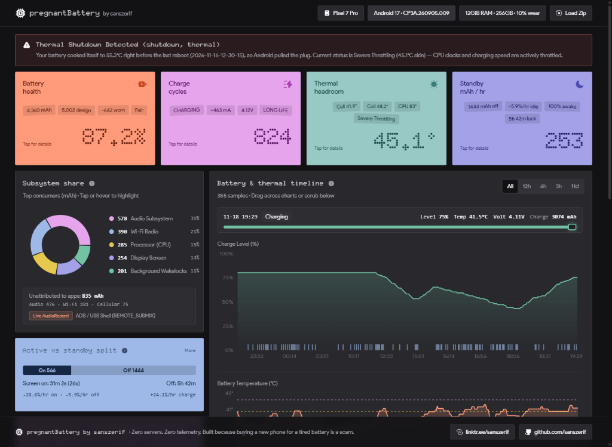

# pregnantBattery

Your phone's battery isn't "optimizing." It's dying. Here's the autopsy.

---

## 1. The Dashboard



- Device & thermal shutdown banner
- Battery health card
- Charge cycles & charging telemetry card
- Thermal headroom card
- Standby drain & wakelock card
- Subsystem share donut & unattributed power breakdown
- Active vs. standby split bar
- BCL load brownouts card
- Wi-Fi & radio drain card
- Battery & thermal timeline (with scrubber & time windows)
- Daily drain/charge pace view
- Power & wakelock attribution table (Apps & Services / Hardware)
- Thermal sensors (3D chassis view & severity list)

---

## 2. Getting the Bug Report

Pick your poison. Both end with a `.zip` file. Neither uploads anything to a server because we don't want to pay for your storage.

### On your phone (no PC required)

1. Open **Settings → About phone**.
2. Tap **Build number** 7 times until it congratulates you for becoming a "developer." Enter your PIN if asked.
3. Go back to **Settings → System → Developer options**.
4. Tap **Bug report** (or **Take bug report**) → **Full report** → **Report**.
5. Wait 1–3 minutes while your phone wheezes through `dumpstate`.
6. Tap the **"Bug report captured"** notification when it appears, share/save it to **Files** (or grab it from your internal storage), and drop that `.zip` into pregnantBattery.

### Using ADB (the civilized way)

1. Enable **USB debugging** in **Settings → System → Developer options**.
2. Plug your phone into your computer and accept the RSA prompt on your phone.
3. Run:
   ```sh
   adb bugreport bugreport.zip
   ```
4. Drop `bugreport.zip` into the dashboard.

---

## 3. How the Math Works

No black-box AI "battery score." Just arithmetic on what Android's `IHealth`, `IThermal`, and `batterystats` already logged.

- **Battery Health & Wear**:
  - Current full capacity comes from `batteryFullChargeUah / 1000` (falling back to `batterystats` estimated capacity, or `chargeCounter / levelPct * 100` when battery level is `>= 20%`).
  - `healthPct = min(100, round((learnedMah / designMah) * 1000) / 10)`. No fake `5000 mAh` fallback if design capacity is missing.
  - `lostMah = max(0, designMah - learnedMah)`.
  - Verdict: `>= 90%` is **Good**, `>= 80%` is **Fair**, `< 80%` is **Worn**.

- **Drain & Charge Rates**:
  - **Screen-on / Screen-off %/hr**: Uses Android's `estScreenOnFullMs` / `estScreenOffFullMs` (`100 / hours`) when `> 60s`, or falls back to step-counter discharge rates (`steps / hours`) when at least 2 steps and `> 60s` exist.
  - **Charge %/hr**: Charge steps divided by charging hours (`>= 2` steps and `> 60s`).
  - **Active & Idle mAh/hr**: `screenOnDischargeMah / screenOnHours` and `screenOffDischargeMah / screenOffHours` (when duration `> 60s`).
  - **Awake while screen off %**: `min(100, round((partialWakelockMs / screenOffMs) * 100))`.

- **Subsystem & Unattributed Power**:
  - Reads global `batterystats` subsystem estimates (`>= 1 mAh`).
  - For subsystems other than `screen`, `ambient_display`, and `phone`, `unattributedMah = max(0, round((subsystemMah - appsMah) * 10) / 10)` — power the hardware burned that no app UID claimed.

- **App & System Attribution**:
  - Ranks UIDs by total `mAh` (keeping `>= 0.5 mAh`, top 30; or top 12 otherwise), combining `batterystats` per-UID drain, screen-off drain, wakelock duration, wakeup alarms, Wi-Fi traffic, and active `AudioRecord` clients.

- **Thermals & BCL Brownouts**:
  - Filters out broken/placeholder HAL sensors (`MINUS`, `<= -40°C`, or `0°C` at `NONE`), then sorts by throttling severity (`SHUTDOWN` → `NONE`) and current temperature.
  - Deduplicates `HAPTICS` BCL brownout counts when they mirror `AUDIO` identically (shared rail on Pixel hardware), then totals light, medium, and heavy throttle events.

- **Timeline & Daily Stats**:
  - Downsamples history to at most ~450 points (always keeping first and last samples) so charts stay fast.
  - Daily drain/charge pace converts daily step counts and durations (`> 60s` and `<= 14 days`) into `%/hr`.
